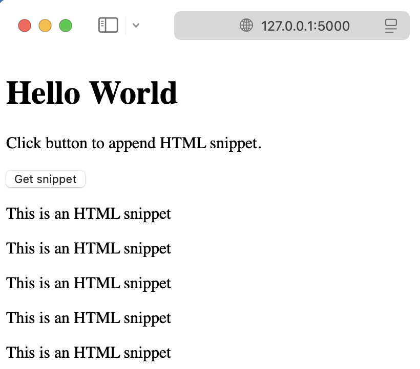

## Append HTML with Datastar and Quart

A Quart app is shown below where each route returns HTML. Notice the snippet route also returns a header containing a `datastar-mode` that defines how to patch elements. In this example `append` is used to append HTML to the `#hal` element which is a div in the index page.

```python
# app.py

from quart import Quart, render_template

app = Quart(__name__)

@app.get("/")
async def index():
    return await render_template("index.html")

@app.get("/snippet")
async def snippet():
    headers = {"datastar-selector": "#hal", "datastar-mode": "append"}
    return await render_template("snippet.html"), headers

app.run()
```

The index page is shown next. It consists of a button with an `data-on` attribute that makes a GET request to the snippet route. The `#hal` div is defined after the button and is where the HTML is appended.

```html
<!-- templates/index.html -->

<!doctype html>
<html lang="en">
  <head>
    <meta charset="utf-8" />
    <meta name="viewport" content="width=device-width, initial-scale=1" />
    <script
      type="module"
      src="https://cdn.jsdelivr.net/gh/starfederation/datastar@1.0.0-RC.7/bundles/datastar.js"></script>
    <title>Example of Datastar</title>
  </head>
  <body>
    <h1>Hello World</h1>

    <p>Click button to append HTML snippet.</p>

    <button data-on:click="@get('/snippet')">Get snippet</button>

    <div id="hal"></div>
  </body>
</html>
```

The HTML snippet that is appended to the `#hal` div is shown next.

```html
<!-- templates/snippet.html -->

<p>This is an HTML snippet</p>
```

Running the Quart app creates the index page shown below. In the image, the button has been clicked five times therefore five HTML snippets were appended to the div.



### Further reading

See the [Datastar](https://data-star.dev) and [Quart](https://quart.palletsprojects.com) documentation for more information about these packages. The code discussed in this article is available in the `pythonic/projects/datastar-append` directory in the [pythonic](https://github.com/wigging/pythonic) GitHub repository.
